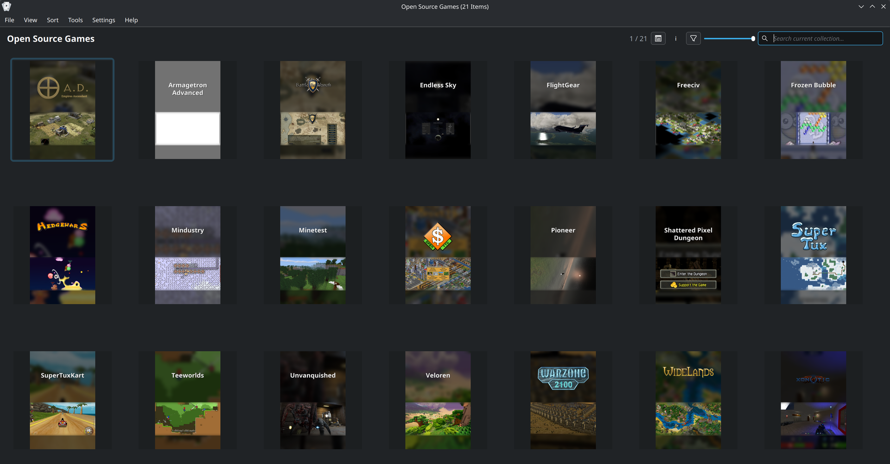
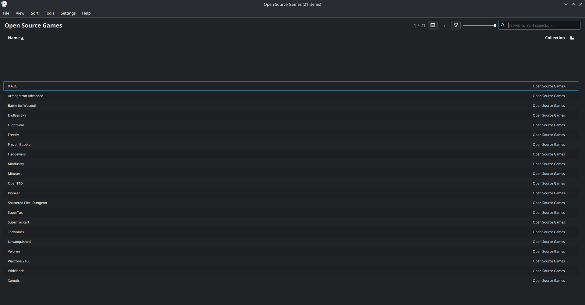
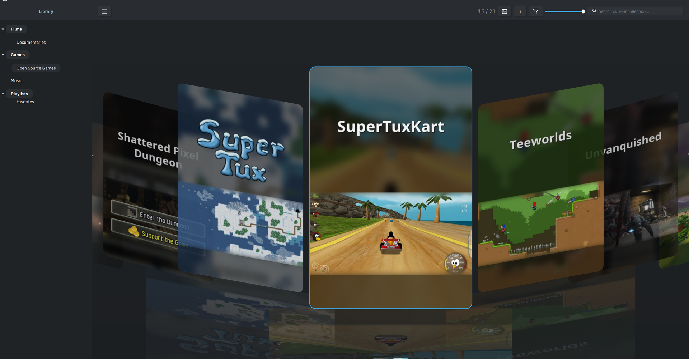
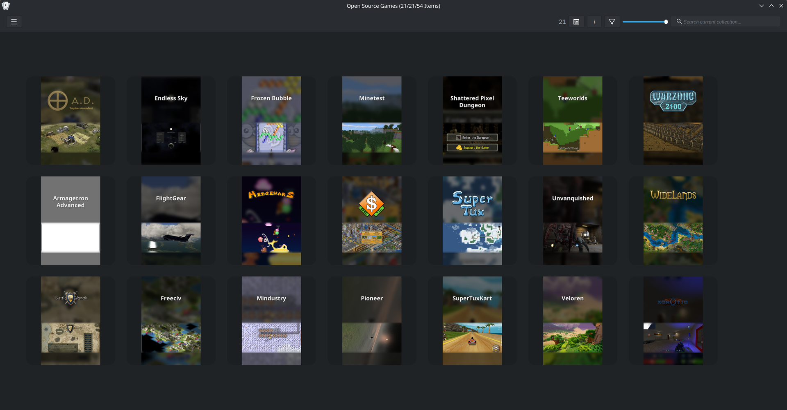
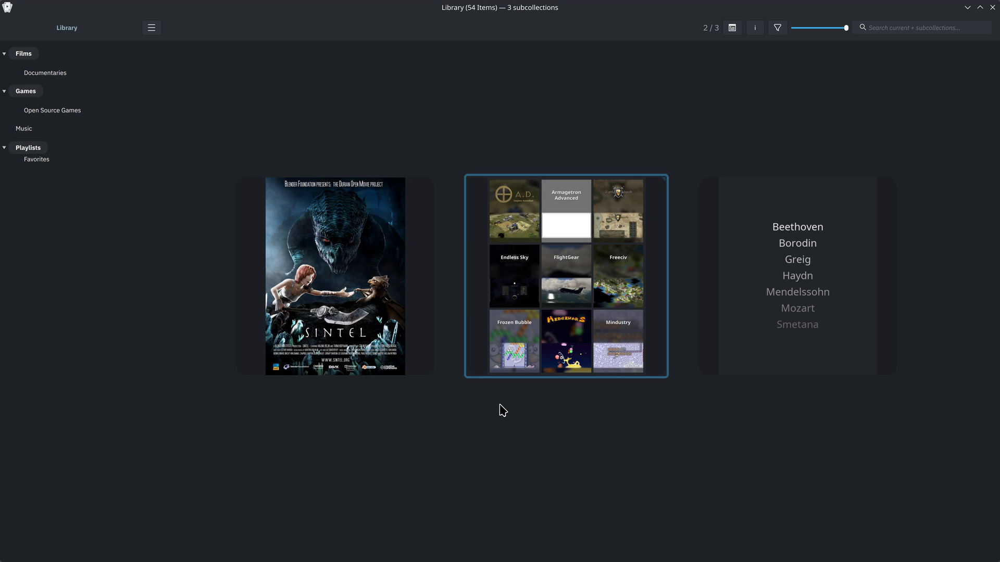

<div align="center">


# Kartend

**Your media. Your artwork. Your way to browse.**

[](https://github.com/EtherAura/Kartend/actions/workflows/build.yml)
[](https://github.com/EtherAura/Kartend/actions/workflows/coverage.yml)
[](https://github.com/EtherAura/Kartend/releases)
[](LICENSE)

A Qt frontend for films, music, books and games on **Linux and Windows**.
Bring your folders, choose your launchers, and make the library yours.

[**Download**](https://github.com/EtherAura/Kartend/releases/latest) · [**Get started**](docs/user/Getting-Started.md) · [**User guide**](https://github.com/EtherAura/Kartend/wiki) · [**Feature tour**](docs/user/Features.md)


</div>

| List | Cover Flow |
|---|---|
|  |  |
| **Horizontal** | **Nested collections** |
|  |  |

Keyboard, mouse or gamepad. [Four layouts](docs/user/View-Modes.md), [metadata and artwork](docs/user/Scraper.md), [emulator and PC launchers](docs/user/Launchers.md).

https://github.com/user-attachments/assets/f4298240-68d6-435a-8276-84d223e5e30a

[More videos](docs/user/Tour.md) · [Media credits](docs/media/screenshot-credits.md)

## Install

Pick a Linux package or Windows download from [Releases](https://github.com/EtherAura/Kartend/releases/latest), then follow the New Library Wizard.
[Installation and verification](docs/user/Installation.md) covers packages, unsigned Windows builds and download provenance.

## Build from source

```bash
.scripts/build.sh
```

[Dependencies and build options](docs/dev/building.md) · [Contributing](CONTRIBUTING.md) · [Development process](docs/dev/Development-Process.md) · [Security](SECURITY.md) · [Discussions](https://github.com/EtherAura/Kartend/discussions)
